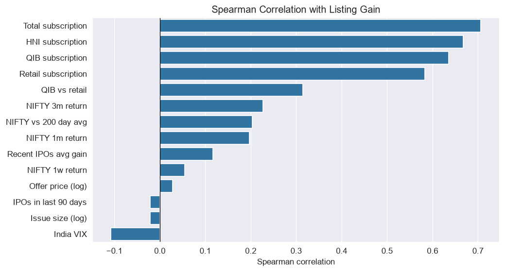
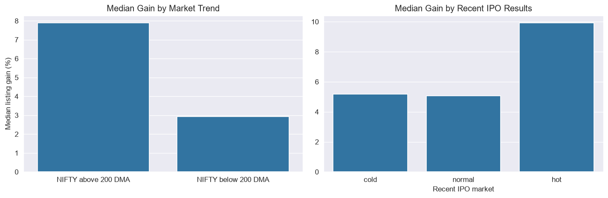
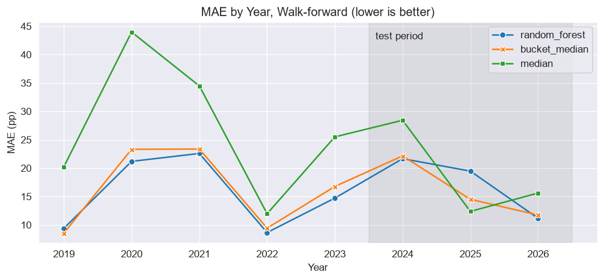
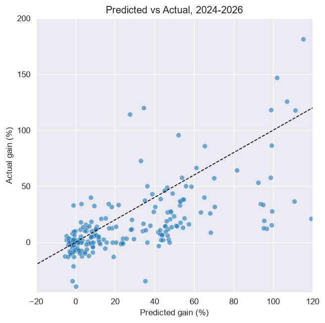
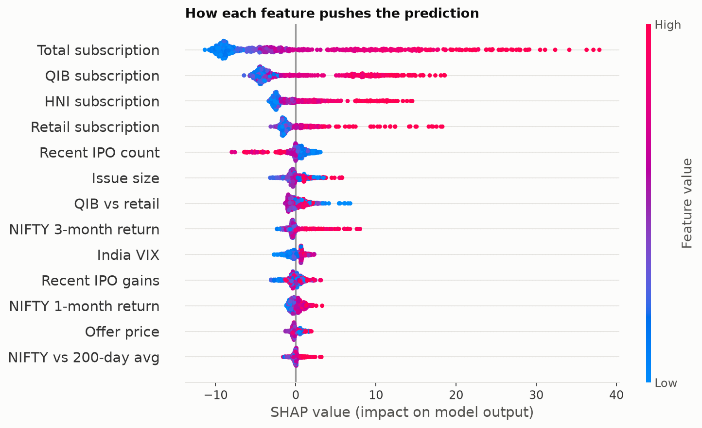
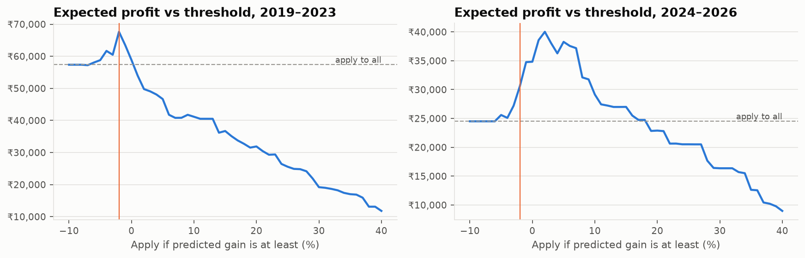

# IPO Listing Day Predictor

Predicts an Indian mainboard IPO's **listing-day gain** the moment subscription closes, before it lists.
It gives an expected gain, a calibrated 80% range, a **SUBSCRIBE / AVOID** call and the reasons behind it,
and it was backtested the way a retail investor would really use it: one lot per IPO, with the allotment lottery.

Built on real data (Kaggle + NSE + Yahoo Finance), 634 IPOs from Jan 2010 to May 2026, plus a one-time forward
test on 78 IPOs from Jun to Nov 2026. Ends in a Streamlit app.

> **In simple words:** a company sells shares to the public for the first time (an IPO). People queue up to buy.
> On the first trading day the price can jump or fall. This project looks at how long the queue was, who stood in
> it, and how the market feels, and guesses that jump before day one. Then it checks whether following those
> guesses would really have made money.

---

## Contents

1. [The project in 1 minute](#1-the-project-in-1-minute)
2. [Results at a glance](#2-results-at-a-glance)
3. [Words you need](#3-words-you-need)
4. [Data: sources, cleaning, checking](#4-data-sources-cleaning-checking)
5. [EDA: seven findings](#5-eda-seven-findings)
6. [The no-peeking rule (data leakage)](#6-the-no-peeking-rule-data-leakage)
7. [Features](#7-features)
8. [The model](#8-the-model)
9. [Backtest: does it make money?](#9-backtest-does-it-make-money)
10. [Forward test on new IPOs](#10-forward-test-on-new-ipos)
11. [The app: Primary Desk](#11-the-app-primary-desk)
12. [How to run it](#12-how-to-run-it)
13. [Interview kit](#13-interview-kit)
14. [Limits and next steps](#14-limits-and-next-steps)
15. [Where is the code?](#15-where-is-the-code)

---

## 1. The project in 1 minute

| Step | What happened |
|---|---|
| **1. Collect** | 652 real IPOs from Kaggle, the NSE company list, listing prices from Yahoo Finance |
| **2. Clean and check** | Fixed names and types, dropped 18 rows, verified 499 listing prices against the NSE open |
| **3. Explore (EDA)** | Subscription is the strongest signal, but it has inflated over time |
| **4. Features** | 18 inputs, all known before listing (13 used by the final model) |
| **5. Model** | Random Forest, tuned with time-series cross-validation, retrained every quarter |
| **6. Money test** | Backtest with the allotment lottery, a bootstrap, a forward test, then the app |

**Say it in 1 minute:**

> "I built a model that predicts an Indian IPO's listing-day gain the moment subscription closes. I took 652 real
> IPOs from Kaggle, matched each one to its NSE symbol, and checked Kaggle's listing prices against the NSE open
> from Yahoo, after fixing Yahoo's split adjustment: 95% agreed. EDA showed subscription is the strongest signal,
> but it has inflated over time, so a model trained once and frozen failed on 2024 to 2026. I switched to
> retraining every quarter. The random forest ranks IPOs best (Spearman 0.71 on unseen years), though a simple
> subscription lookup is as good on the exact number, which I report openly. Its real value is the apply / skip
> call: following it, a retail investor's expected profit was ₹30,588 vs ₹24,506 for applying to everything, and a
> bootstrap shows that edge is real. A one-time forward test on 78 newer IPOs told the same story. It all runs in a
> Streamlit app that gives a Subscribe / Avoid call with a calibrated 80% range and the reasons."

---

## 2. Results at a glance

| | |
|---|---|
| **Data** | Raw Kaggle file: **652 rows × 13 columns**. After cleaning: **634 IPOs** (Jan 2010 – May 2026); feature table 634 rows × 31 columns. Listing prices cross-checked against the NSE open, 95% agree |
| **Typical IPO** | Median listing gain 6.6%; 1 in 4 IPOs list below the offer price |
| **Testing** | Tuned on 2010–2023 with time-series cross-validation (year folds); evaluated walk-forward, refit every quarter; 2024–2026 never used to choose anything |
| **Ranking quality, 2024–26** | Spearman **0.71**, best of all models (subscription lookup 0.67) |
| **Average miss, 2024–26** | MAE 19.52 pp (subscription lookup 17.26 pp) |
| **80% range, 2024–26** | Actual gain fell inside the range for **79%** of IPOs |
| **Backtest, 2024–26** | Following the model: **₹30,588** expected profit vs ₹24,506 applying to every IPO; bootstrap 95% interval for the difference ₹1,241 to ₹11,978 |
| **Forward test, Jun–Nov 2026** | 78 IPOs collected after the model was frozen, scored once: Spearman 0.72, range covered 87%, model ₹13,781 vs ₹12,064 apply-all vs ₹8,122 for the 30x rule |
| **Honest limit** | A simple subscription-bucket lookup matched or beat the model on exact-gain error in both test periods (2024–26: 17.3 vs 19.5 pp; forward: 14.5 vs 15.4 pp). The model's value is ranking and the apply / skip call, not the exact number |

<details>
<summary><b>The whole project in eight numbers</b></summary>

| Number | Meaning |
|---|---|
| **634** | mainboard IPOs used, Jan 2010 to May 2026 (652 in the raw file) |
| **499** | listing prices verified against the NSE open (95% of the ones that could be checked) |
| **6.6%** | median listing gain of an IPO |
| **1 in 4** | IPOs list below the offer price (25.2%) |
| **18** | features, all known before the IPO lists (13 used) |
| **0.71** | ranking score (Spearman) on 2024 to 2026, years the model never saw |
| **₹30,588** | expected profit following the model, vs ₹24,506 applying to every IPO (2024 to 2026) |
| **78** | brand-new IPOs (Jun to Nov 2026) used as a final, one-time exam |

</details>

---

## 3. Words you need

IRCTC's IPO (October 2019) is used as the example everywhere in this README.

| Word | Plain English | Technical meaning | Example (IRCTC) |
|---|---|---|---|
| IPO | A company sells its shares to the public for the first time | Initial Public Offering | IRCTC, Oct 2019 |
| Offer price | The price you pay when you apply | Issue price (upper end of the price band) | ₹320 |
| Listing day | First day the share trades on the exchange | Listing date | 14 Oct 2019 |
| **Listing gain** | How much the price jumped (or fell) at the start of day one | (listing-day open ÷ offer price − 1) × 100. **This is the target** | opened ₹626 → **+95.6%** |
| Subscription | How many times more shares were asked for than offered | Bids ÷ shares offered, per investor group | 111.95x overall |
| QIB | Big professional investors: mutual funds, banks, foreign funds | Qualified Institutional Buyers | 108.8x |
| HNI / NII | Rich individuals applying for more than ₹2 lakh | Non-Institutional Investors | 354.5x |
| Retail (RII) | Normal people applying for up to ₹2 lakh | Retail Individual Investors | 14.9x |
| Lot | The smallest packet you can apply for | Minimum bid lot, ~₹15,000 | – |
| Allotment | Actually getting shares. When too many apply, it is a lottery | Odds ≈ 1 ÷ retail subscription | ~1 in 15 |
| NSE / BSE | India's two big stock exchanges | National / Bombay Stock Exchange | NSE open ₹626, BSE ₹644 |
| NIFTY 50 | Shows if India's 50 biggest companies are going up or down | Stock market index | – |
| India VIX | The market's "fear meter" | Volatility index | 17.8 a week before IRCTC listed |
| 200-DMA | Average price of the last 200 trading days; above it = good mood | 200-day moving average | NIFTY 1.2% below it |
| REIT / InvIT | Not a company: a trust that owns buildings or roads | Real estate / infrastructure investment trust | removed |
| FPO | An already listed company selling more shares | Follow-on Public Offer | Vodafone Idea 2024, removed |
| GMP | Unofficial "street price" before listing | Grey Market Premium | **not used**: unofficial, not verifiable |
| pp | Difference between two percentages | Percentage points | 101.3% vs 95.6% = 5.6 pp |

---

## 4. Data: sources, cleaning, checking

Notebook: [`notebooks/01_data_cleaning.ipynb`](notebooks/01_data_cleaning.ipynb)

> **In simple words:** I didn't trust one source. Kaggle has the subscription numbers but no stock symbol, and
> some of its listing prices looked wrong. So I found each IPO on NSE's own list and checked its price on Yahoo,
> like asking two friends the same question.

### 4.1 Sources

| Need | Source | Rows |
|---|---|---|
| IPO list, issue size, QIB / HNI / RII subscription, listing gain | Kaggle: [IPO Data India 2010–2026](https://www.kaggle.com/datasets/karanammithul/ipo-data-india-2010-2025) | 652 |
| Symbol, ISIN, listing date, mainboard vs SME | NSE `EQUITY_L.csv` (2,646) and `SME_EQUITY_L.csv` (584) | 3,230 |
| Listing-day prices | Yahoo Finance (`<SYMBOL>.NS`), split-restored | 547 |
| Market mood | Yahoo Finance: NIFTY 50 (`^NSEI`), India VIX (`^INDIAVIX`) | ~4,380 days each |
| New IPOs, Jun–Nov 2026 | Collected by hand from news and broker pages, two sources each | 127 candidates, 78 usable |

Rules: every raw file is logged with its source, date and SHA-256 in `data/raw/manifest.json`; raw files are never
edited; mainboard only; **GMP is not used** (unofficial, no checkable history); no scraping of sites whose terms forbid it.

### Total rows and columns at every stage

| Stage | File | Rows | Columns | What a row is |
|---|---|---|---|---|
| Raw | `data/raw/kaggle/Initial Public Offering (Updated).xlsx` | **652** | **13** | one IPO, as downloaded |
| Raw | `data/raw/nse/EQUITY_L.csv` | 2,646 | 8 | one company on NSE's mainboard |
| Raw | `data/raw/nse/SME_EQUITY_L.csv` | 584 | 8 | one company on NSE's SME platform |
| Raw | `data/raw/market/nifty50.csv` | 4,384 | 6 | one trading day of NIFTY 50 |
| Raw | `data/raw/market/india_vix.csv` | 4,383 | 6 | one trading day of India VIX |
| Cleaned | `data/interim/ipos_kaggle.csv` | 652 | 13 | one IPO, renamed and typed (CMP columns dropped, flags and id added) |
| Matched | `data/interim/ipos_matched.csv` | 652 | 19 | + NSE symbol and match score |
| Prices | `data/interim/listing_bars.csv` | 547 | 9 | listing-day open / high / low / close of each matched symbol |
| Checked | `data/interim/ipos_verified.csv` | 652 | 30 | + Yahoo prices, check label, target, `exclude_reason` |
| **Used for the model** | rows with no `exclude_reason` | **634** | – | 652 − 18 removed |
| Features | `data/processed/ipo_features.csv` | **634** | **31** | one IPO with all 18 features and the target |
| Dev (practice) | features with year < 2024 | **432** | – | 2010–2023 |
| Test (final exam) | features with year ≥ 2024 | **202** | – | 2024 – May 2026 |
| Tuning results | `data/processed/cv_results.csv` | 94 | 7 | one setting tried in the grid |
| Walk-forward predictions | `data/processed/wf_predictions.csv` | 394 | 17 | one IPO from 2019 on (192 in 2019–23 + 202 in 2024–26) |
| New IPOs, collected | `data/manual/new_ipos.csv` | 127 | 19 | one candidate listing, Jun–Nov 2026 |
| Forward test | `data/processed/forward_predictions.csv` | **78** | 14 | one usable new IPO |
| App's model | – | **712** | – | 634 + 78 IPOs used for the final refit |

### 4.2 Columns

| # | Raw column | Plain English | IRCTC | What I did |
|---|---|---|---|---|
| 1 | Date | Listing date | 2019-10-14 | → `listing_date`, real date |
| 2 | IPO_Name | Company name | Indian Railway Catering… | → `ipo_name`, fixed 69 cut-off names |
| 3 | Issue_Size(crores) | Money raised | 637.97 | → `issue_size_cr` |
| 4 | QIB | Institutions' subscription | 108.79 | → `sub_qib` |
| 5 | HNI | Rich individuals' subscription | 354.52 | → `sub_hni` |
| 6 | RII | Retail subscription | 14.94 | → `sub_rii` |
| 7 | Total | Overall subscription | 111.95 | → `sub_total` |
| 8 | Offer Price | Price paid in the IPO | 320 | → `offer_price` |
| 9 | List Price | First price on listing day | 644 (BSE open) | → `list_price`, checked against NSE |
| 10 | Listing Gain | Kaggle's listing gain % | 101.25 | → `listing_gain_pct`, checked against NSE |
| 11–13 | CMP(BSE), CMP(NSE), Current Gains | Today's price | 726.65 … | **dropped**: nobody knows today's price on listing day (**data leakage**) |

### 4.3 Cleaning

| # | What I did | How | Why |
|---|---|---|---|
| 1 | Renamed columns | `Issue_Size(crores)` → `issue_size_cr`, … | Short, consistent names |
| 2 | Fixed cut-off names | 69 names ended in "..."; removed it, kept a `name_truncated` flag | The name is needed to find the NSE symbol |
| 3 | Fixed datatypes | `pd.to_datetime`, numbers → `float` | Can't sort or average text |
| 4 | Duplicates | `df.duplicated().sum()` → **0** | – |
| 5 | Missing values | `missing_info(df)`: 3 IPOs miss subscription or listing gain → dropped | A row with no answer can't teach anything |
| 6 | Outliers: checked, **kept** | `out_info(df)` + boxplots; used log scale and MAE instead | 300x subscriptions and Hyundai's ₹27,859 cr IPO are real and matter most |
| 7 | Marked REITs / InvITs | By name or retail subscription = 0: 14 rows | Trusts have no retail quota |
| 8 | Dropped rows | 14 REITs / InvITs + 1 FPO + 3 missing = **18**; reason kept in `exclude_reason` | First-time company IPOs only; nothing disappears silently |
| 9 | Sorted and gave ids | By date, then name; `IPO0001`, `IPO0002`, … | Time order matters for everything later |

| Step | IPOs |
|---|---|
| Raw Kaggle file | 652 |
| − REITs / InvITs | −14 |
| − FPO (Vodafone Idea) | −1 |
| − missing subscription or listing gain | −3 |
| **Clean IPOs for the model** | **634** |

### 4.4 Finding each IPO's NSE symbol

| # | What I did | Why |
|---|---|---|
| 1 | Cleaned both names: lowercase, "&" → "and", removed Ltd / Limited / Pvt / the / IPO | "Larsen & Toubro Infotech Ltd." and "Larsen and Toubro Infotech Limited" become the same |
| 2 | Only looked at NSE companies listed within **±7 days** of the Kaggle date | Fewer candidates, fewer wrong matches |
| 3 | Scored name similarity with `rapidfuzz` (best of word-order, start-of-name, shared-words scores) | Handles word order and cut-off names |
| 4 | Accepted only a score of **85+** | Better no symbol than a wrong one |
| 5 | Fixed a bad match: "VMS Industries" matched "PI Industries"; shared words now count only if the first word also matches | Found by checking the lowest-score matches by eye |

Result: **547** IPOs matched, **105** not matched (mostly delisted, merged, or BSE-only).

**So I** had an NSE symbol for 547 IPOs, which let me fetch their real listing-day price from Yahoo.

### 4.5 The split problem

> **In simple words:** cut a pizza into 5 slices and each slice is worth one fifth. Companies do this with shares
> (a split or bonus). Yahoo then quietly divides all old prices too, so IRCTC's first-day price shows as ~₹125
> instead of ₹626.

For each IPO, the first-day prices were multiplied by every split ratio after the listing day (`split_factor`).
90 of the 545 IPOs with a price had a later split or bonus. **Before the fix only ~63% of prices agreed; after it, 95%.**

**So I** always used the split-restored NSE open; without it about 1 in 6 targets would have been wrong.

### 4.6 Checking Kaggle's numbers

| Difference between Kaggle's gain and the NSE-open gain | Label | IPOs |
|---|---|---|
| 2 pp or less | agree | 390 |
| 2 to 10 pp | close (Kaggle often used BSE's open) | 109 |
| more than 10 pp | disagree | 26 |
| **Agree or close, out of 525 checkable** | | **499 (95.0%)** |

Disagreements were checked by hand against news (CDSL ₹250, Paras Defence ₹475, Nazara ₹1,971, Bansal Wire ₹352):
**Kaggle was right**, Yahoo's split history was wrong.

**So I** used the NSE-open gain where the two sources agree, and kept Kaggle's number (marked unverified) everywhere else:

| Case | Target used | Marked as | IPOs |
|---|---|---|---|
| agree or close | gain from the NSE open | `nse_open_yahoo` | 499 |
| disagree, not on NSE, no price | Kaggle's listing gain | `kaggle_unverified` | 135 |

**IRCTC before and after:** Kaggle listing price 644 (BSE open), gain 101.25% → NSE open 626 (split-corrected),
check = close (5.6 pp apart) → **target 95.6%**.

---

## 5. EDA: seven findings

Notebooks: [`02_eda.ipynb`](notebooks/02_eda.ipynb), [`03_feature_engineering.ipynb`](notebooks/03_feature_engineering.ipynb)

> **In simple words:** before building the guessing machine, I looked at the old IPOs with tables and charts to see
> what usually happens. Each finding became a decision for the model.

### Summary

| # | Question | What the data showed | Decision for the model |
|---|---|---|---|
| 1 | How do IPOs usually list? | Median **+6.6%**, mean 16.8%; **1 in 4** list below offer | MAE as main score; also predict an 80% range |
| 2 | Is every year the same? | 4 IPOs in 2013, 102 in 2025; median gain −2.8% to +23.4% | Split by **time**, never randomly |
| 3 | Longer queue = bigger jump? | Below 3x: under half list up; above 30x: **9 in 10** do | Log of subscription; **bucket median** as the baseline |
| 4 | Whose demand matters most? | Total 0.71, HNI 0.67, QIB 0.64, retail 0.58 (Spearman) | Keep all four groups + `qib_to_rii`; Ridge for the linear model |
| 5 | Do big IPOs list differently? | Size groups all ~5–8% median | Keep size (log); not a signal alone |
| 6 | Does market mood help? | NIFTY above 200-DMA: 7.9% vs 2.9% | Add NIFTY, VIX and recent-IPO features |
| 7 | Does 50x mean the same in 2012 and 2025? | Typical IPO 4.9x → 28x; 100x+ gain 75% → 36.5% | **Retrain every quarter** (walk-forward) |

### Finding 1: most IPOs list a little up; a few list hugely up

| Measure | Value |
|---|---|
| Median gain | 6.6% |
| Mean gain | 16.8% |
| Skew | 2.5 (long right tail) |
| Listed below offer price | 25.2% |
| Listed flat (0%) | 6.3% |
| Gain above 15% | 34.2% |
| Gain above 50% | 11.5% |


### Finding 2: IPOs come in waves

| Year | IPOs | Median gain | % listed below offer |
|---|---|---|---|
| 2010 | 74 | 5.4% | 21.6% |
| 2013 | 4 | 4.9% | 25.0% |
| 2020 | 15 | 23.4% | 26.7% |
| 2021 | 63 | 16.0% | 25.4% |
| 2023 | 59 | 17.1% | 10.2% |
| 2024 | 80 | 15.8% | 20.0% |
| 2025 | 102 | 5.7% | 20.6% |
| 2026 (to May) | 20 | −2.8% | 55.0% |


### Finding 3: subscription is the strongest signal

> **In simple words:** 100 laddoos, 10,000 people in the queue. 9,900 go home empty-handed and will pay more
> the next day. That is why a long queue pushes the listing price up.

| Total subscription | IPOs | Median gain | % listed with a gain |
|---|---|---|---|
| less than 1x | 26 | 0.0% | 38% |
| 1 to 3x | 177 | 0.0% | 41% |
| 3 to 10x | 104 | 3.9% | 62% |
| 10 to 30x | 90 | 9.9% | 70% |
| 30 to 100x | 164 | 23.3% | **92%** |
| 100x and more | 73 | **56.6%** | **100%** |


### Finding 4: rich individuals and institutions matter more than retail

| Column | Spearman with gain |
|---|---|
| Total subscription | 0.71 |
| HNI subscription | 0.67 |
| QIB subscription | 0.64 |
| Retail subscription | 0.58 |
| Offer price | 0.03 |
| Issue size | −0.02 |

The four subscription columns move together (0.64 to 0.93 with each other): **multicollinearity**. Trees don't mind;
the linear model uses Ridge.

### Finding 5: issue size alone says little

| Size group | Range (₹ cr) | Median gain | Median subscription |
|---|---|---|---|
| Smallest 25% | 23 – 257 | 6.3% | 6.3x |
| Small-mid | 260 – 583 | 7.2% | 21.0x |
| Mid-large | 583 – 1,204 | 8.4% | 20.3x |
| Largest 25% | 1,210 – 27,859 | 5.3% | 7.8x |

### Finding 6: market mood helps a little

| Situation | Median gain |
|---|---|
| NIFTY above its 200-day average | 7.9% |
| NIFTY below its 200-day average | 2.9% |
| Recent IPOs cold / normal / hot | 5.2% / 5.1% / 9.9% |




### Finding 7: subscription has inflated

| Subscription | 2010–2019 | 2020–2023 | 2024–2026 |
|---|---|---|---|
| less than 3x | −0.1% | 0.1% | −1.0% |
| 3 to 10x | 4.2% | 3.8% | 0.0% |
| 10 to 30x | 11.3% | 12.7% | 6.5% |
| 30 to 100x | 25.1% | 36.9% | 14.1% |
| 100x and more | 59.2% | **75.0%** | **36.5%** |
| Median subscription | 4.9x | 22.6x | 28.0x |

> **In simple words:** when everyone starts standing in every queue, a long queue means less. Queues got 6 times
> longer, and the jump for the same queue got about half as big. A model trained once will expect too much.

---

## 6. The no-peeking rule (data leakage)

> **In simple words:** in an exam you can't look at tomorrow's newspaper. The model may only use what a person could
> know **before** the IPO lists. If it peeks at the future, it looks clever in testing and fails in real life.

| Day | What happens | For the model |
|---|---|---|
| **−7 (cutoff)** | – | Last day of market data the model may use |
| −6 to −4 | IPO open for applications (3 working days) | – |
| −3 | Applications close, subscription known | The model makes its call |
| **0** | Listing day | The answer. Never an input |

**Why 7 days?** Since Dec 2023 an IPO lists 3 working days after applications close (T+3); before that the gap was up
to 6 days. 3 working days can be 5–6 calendar days with a weekend or holiday, so 7 calendar days puts the cutoff before
applications close for every IPO. Small loss of signal, but no future information can slip in.

**Every guard against leakage:**

| # | What I did | What it stops |
|---|---|---|
| 1 | Market data only up to the cutoff, 7 days before listing | Seeing the market around listing day |
| 2 | Dropped CMP (BSE), CMP (NSE), Current Gains | Using today's price |
| 3 | "Recent IPOs" counts only IPOs listed before the cutoff | Seeing how later IPOs did |
| 4 | 7-day gap between training and validation in every fold | A test IPO's neighbour sitting in training |
| 5 | Walk-forward: each quarter predicted by a model trained only on earlier IPOs | Any guess made with later results |
| 6 | Missing values filled inside the pipeline, from training rows only | Test data leaking through the fill value |
| 7 | Automated test: adding later IPOs never changes an earlier IPO's features | Future data creeping into past rows |

---

## 7. Features

Notebook: [`03_feature_engineering.ipynb`](notebooks/03_feature_engineering.ipynb). 18 built, **13 used** by the final model.

| Group | Feature | Plain English | How it is made | IRCTC |
|---|---|---|---|---|
| The queue | `log_sub_total` | How long the whole queue was | log(1 + total) | 4.73 (111.95x) |
| | `log_sub_qib` | Institutions' queue | log(1 + QIB) | 4.70 |
| | `log_sub_hni` | Rich individuals' queue | log(1 + HNI) | 5.87 |
| | `log_sub_rii` | Retail queue | log(1 + retail) | 2.77 |
| | `qib_to_rii` | Professionals keener than retail? | log QIB − log retail | 1.93 |
| | `fully_subscribed` | At least 1x? | 1 / 0 | 1 |
| The issue | `log_issue_size` | How big the IPO was | log(₹ crore) | 6.46 |
| | `log_offer_price` | Price of one share | log(offer price) | 5.77 |
| Queue vs last year | `sub_total_vs_recent` | Longer than usual for its time? | log sub − median log sub of IPOs in the 365 days before the cutoff (needs 5+) | 3.69 |
| | `sub_qib_vs_recent`, `sub_hni_vs_recent` | Same for QIB, HNI | same | 3.29, 4.88 |
| Market mood (at cutoff) | `nifty_ret_1w`, `_1m`, `_3m` | Market up last week / month / 3 months? | % change over 5 / 21 / 63 trading days | −3.35%, +2.60%, −6.63% |
| | `nifty_vs_200dma` | Long-term mood | % above / below 200-day average | −1.15% |
| | `vix` | How scared is the market? | India VIX close | 17.83 |
| Recent IPOs (90 days before cutoff) | `recent_ipo_count` | How many listed recently | count | 3 |
| | `recent_ipo_mean_gain` | Did they do well? | average listing gain | 3.90% |

**Used by the final model (13):** `log_sub_qib, log_sub_hni, log_sub_rii, log_sub_total, qib_to_rii, log_issue_size,
log_offer_price, nifty_ret_1m, nifty_ret_3m, nifty_vs_200dma, vix, recent_ipo_mean_gain, recent_ipo_count`.
The 3 "vs recent" features were tried and did not help on validation; `fully_subscribed` and `nifty_ret_1w` were built but not used.

**Why log?** Queues go from 1x to 300x+. A log ruler puts 1x → 0.7, 10x → 2.4, 100x → 4.6, 300x → 5.7, so every size gets a fair say.

**Missing values:** `recent_ipo_mean_gain` (12, no IPO in the 90 days) and `sub_*_vs_recent` (10, fewer than 5 IPOs
in the year) are filled with the median **inside the model pipeline**, so the median comes from training data only.

---

## 8. The model

Notebook: [`04_modeling.ipynb`](notebooks/04_modeling.ipynb) (scripts: `src/models/train.py`, `walk_forward.py`, `evaluate.py`)

> **In simple words:** the model is a student. Old IPOs are practice questions with answers. It practises on old
> years, then sits an exam on newer years it has never seen. If it only does well on practice questions, it just
> memorised them.

Every step below follows the same pattern: **what I did → what the numbers showed → so what I did next.**

| Step | What I did | What I saw | So I… |
|---|---|---|---|
| [1](#step-1-split-the-data-by-time) | Split by time | Years behave very differently | kept 2024–26 as a hidden final exam |
| [2](#step-2-choose-the-validation-time-series-cross-validation) | Chose the validation | Shuffled KFold would use the future | used time-series cross-validation by year |
| [3](#step-3-build-two-baselines) | Built 2 baselines | Bucket median misses 16.26 | set it as the line to beat |
| [4](#step-4-first-try-of-three-models) | Tried 3 models | Trees: 3.7 on practice, 14.9 on new years | treated it as overfitting and tuned |
| [5](#step-5-tune-the-settings-94-combinations) | Tuned 94 settings | RF best (16.03); extras didn't help | kept RF depth 8, leaf 5, 13 features |
| [6](#step-6-exam-1-freeze-the-model-and-test-on-2024-26) | Froze and tested | Every model lost to the bucket median | looked for the reason |
| [7](#step-7-find-the-reason-subscription-inflation) | Compared eras | 100x+ gain fell 75% → 36.5% | decided to retrain every quarter |
| [8](#step-8-walk-forward-retrain-every-quarter) | Walk-forward 2019–23 | RF lowest miss (16.13) | chose Random Forest |
| [9](#step-9-final-exam-walk-forward-on-2024-26) | Walk-forward 2024–26 | Lookup wins MAE, RF wins ranking | judged it by ranking and by money (backtest) |
| [10](#step-10-predict-a-range-not-one-number) | Built an 80% range | Raw range caught only 56–67% | added conformal calibration (79%) |
| [11](#step-11-explain-each-guess-shap) | Explained guesses | Subscription drives the guess | used SHAP for the app's reasons |
| [12](#step-12-final-model) | Final refit | – | refit on all 712 IPOs for the app |

### Step 1: split the data by time

**What I did:** kept the newest years hidden as the final exam.

| Part | Years | IPOs | Used for |
|---|---|---|---|
| Dev (practice) | 2010–2023 | 432 | learning and choosing everything |
| Test (final exam) | 2024 – May 2026 | 202 | checked only at the end |

**Why:** EDA Finding 2 and 7: years behave very differently (median gain −2.8% to +23.4%) and subscription keeps inflating.

**So I** used a **time-based train-test split** (hold-out test set), never a random `train_test_split`: a random split
would learn from 2025 IPOs and be tested on 2019 IPOs, which leaks the future.

### Step 2: choose the validation (time-series cross-validation)

**What I did:** looked at three ways to make practice tests inside 2010–2023.

| Option | Used? | Why |
|---|---|---|
| `KFold(shuffle=True)` (class helper `regression_eval`) | No | Mixes years: learns from 2023 to predict 2019 |
| scikit-learn `TimeSeriesSplit` | No | Cuts by row count, not calendar year; its gap counts rows, not days |
| **Year folds with a 7-day gap** (`year_folds()`) | **Yes** | Each test is one whole year; training is always before it |

```python
def year_folds(d):
    for year in range(2019, 2024):
        cutoff = pd.Timestamp(year, 1, 1) - pd.Timedelta(days=7)
        yield d.index[d["listing_date"] < cutoff], d.index[d["year"] == year]
```

**What it produced:**

| Test year | Learnt from (IPOs) | Tested on (IPOs) |
|---|---|---|
| 2019 | 240 (up to 25 Dec 2018) | 16 |
| 2020 | 255 | 15 |
| 2021 | 271 | 63 |
| 2022 | 331 | 39 |
| 2023 | 371 | 59 |

**So I** used **time-series cross-validation with an expanding window** (forward chaining): the training set grows every
year, and every score is on a year the model had not seen. The 7-day gap matches the market features, which look 7 days back.

### Step 3: build two baselines

**What I did:** two models with no ML, scored on the same folds.

| Baseline | How it guesses | Valid MAE | Valid R² |
|---|---|---|---|
| Median | Same number for every IPO (median of all past IPOs) | 27.26 | −0.34 |
| **Bucket median** | Median gain of past IPOs in the same subscription group (<1x, 1–3x, 3–10x, 10–30x, 30–100x, 100x+) | **16.26** | 0.51 |

**What I saw:** the bucket median, what an investor does by eye, is already decent (misses ~16 points).

**So I** set the bucket median as **the line to beat**. If ML can't beat it, ML is not worth it.

### Step 4: first try of three models

**What I did:** on the 432 dev IPOs (2010–2023), trained Ridge (straight line), Random Forest (400 trees that vote) and
LightGBM (trees built one after another) with default-ish settings, and measured the miss on the training years and on
the next year (`time_eval()`, average of the 5 year folds: 192 validation IPOs in total).

| Model | Train MAE | Valid MAE | Train R² | Valid R² |
|---|---|---|---|---|
| Ridge, alpha 1 | 11.80 | 18.50 | 0.53 | 0.38 |
| Random Forest, no limit | **3.70** | 14.88 | 0.94 | 0.56 |
| LightGBM, 500 trees, 31 leaves | **3.85** | 15.85 | 0.92 | 0.50 |

**What I saw:** the trees miss by ~4 points on years they trained on but ~15 on new years. They memorise the training
IPOs. Ridge has a small gap but is weak (18.50, worse than the bucket median).

**So I** treated it as **overfitting** and moved to tuning with limits on the trees (regularization).

### Step 5: tune the settings (94 combinations)

**What I did:** a small grid search on the 432 dev IPOs, every combination scored on the 5 year folds (192 validation
IPOs, 2019–2023). 94 combinations in total (rows of `cv_results.csv`).

| Model | Settings tried |
|---|---|
| Ridge | alpha: 0.3, 3, 30 |
| Random Forest | max_depth: 4, 8 · min_samples_leaf: 5, 15 (400 trees, max_features 0.5) |
| LightGBM | n_estimators: 200, 500 · num_leaves: 7, 15 · min_child_samples: 10, 25 · objective: l2, huber |
| Data options (every model) | features: 13 base / +3 "vs last year" · old years: equal weight / half-life 4 years |

**What I saw (best of each model):**

| Model | Best setting | MAE | Median miss | RMSE | Spearman |
|---|---|---|---|---|---|
| **Random Forest** | depth 8, min leaf 5 | **16.03** | **9.59** | **26.62** | **0.76** |
| LightGBM | 200 trees, 15 leaves, min child 25 | 16.45 | 9.73 | 27.07 | 0.74 |
| Bucket median | – | 17.21 | 10.12 | 27.95 | 0.71 |
| Ridge | alpha 30 | 18.71 | 11.61 | 29.32 | 0.73 |
| Median | – | 26.74 | 13.10 | 43.60 | −0.02 |

And the overfitting gap after tuning:

| Model | Train MAE | Valid MAE |
|---|---|---|
| Random Forest, no limit (before) | 3.70 | 14.88 |
| **Random Forest, depth 8, leaf 5 (after)** | **7.02** | **15.39** |
| LightGBM, tuned | 6.91 | 15.75 |

- All winners used the **13 base features** and **equal weights**: the extras did not lower the error.
- The gap shrank from ~4 vs ~15 to ~7 vs ~15.
- Honest note: the no-limit forest was slightly better on valid (14.88 vs 15.39); the grid only tried depth 4 and 8.

**So I** kept **Random Forest, `max_depth=8`, `min_samples_leaf=5`, 13 base features**. A limited forest is safer when the
market shifts, and a small grid means less chance of a lucky winner. "No depth limit" is a next step to test.

### Step 6: Exam 1, freeze the model and test on 2024-26

**What I did:** trained the best settings once on 2010–2023 and scored 2024–2026 without any update.

| Model | MAE on 2024–26 |
|---|---|
| **Bucket median** | **17.94** |
| Median | 18.98 |
| Ridge | 21.29 |
| Random Forest | 22.03 |
| LightGBM | 24.61 |

**What I saw:** every ML model **lost** to the simple bucket median.

**So I** did not hide it. I looked for the reason.

### Step 7: find the reason (subscription inflation)

**What I did:** compared the median gain of the same subscription group in three eras.

| Subscription | 2010–2019 | 2020–2023 | 2024–2026 |
|---|---|---|---|
| 30 to 100x | 25.1% | 36.9% | 14.1% |
| 100x and more | 59.2% | **75.0%** | **36.5%** |
| Median subscription | 4.9x | 22.6x | 28.0x |

**What I saw:** queues got about 6 times longer, and the jump for the same queue roughly halved. A model frozen in 2023
still expects the 2021 frenzy. This is **concept drift**.

**So I** decided to **retrain every quarter** (nobody would use a model for 3 years without updating it anyway).

### Step 8: walk-forward, retrain every quarter

**What I did:** for each quarter from 2019, trained on every IPO listed before (quarter start − 7 days) and predicted
that quarter's IPOs (`walk_forward()`). This gives a prediction for 394 IPOs (2019 onwards). Scored the **192 IPOs of
2019–2023** to choose the model.

| Model | MAE | Median miss | RMSE | R² | Spearman | Within ±10 pp | Direction right |
|---|---|---|---|---|---|---|---|
| **Random Forest** | **16.13** | **9.15** | **27.01** | **0.50** | **0.76** | **53.6%** | **77.1%** |
| LightGBM | 16.23 | 9.96 | 27.20 | **0.50** | 0.75 | 50.5% | 75.0% |
| Bucket median | 17.27 | 10.12 | 28.22 | 0.46 | 0.70 | 49.0% | 75.0% |
| Ridge | 18.69 | 12.01 | 29.31 | 0.42 | 0.73 | 45.8% | 70.8% |
| Median | 26.70 | 12.92 | 43.47 | −0.28 | 0.03 | 38.5% | 73.4% |

**What I saw:** Random Forest is best on every number.

**So I** chose **Random Forest** as the final model, before looking at 2024–2026.

### Step 9: final exam, walk-forward on 2024-26

**What I did:** scored the same walk-forward predictions on the 202 hidden IPOs.

| Model | MAE | Median miss | RMSE | R² | Spearman | Within ±10 pp | Direction right |
|---|---|---|---|---|---|---|---|
| **Random Forest** (chosen) | 19.52 | 12.13 | 27.99 | 0.15 | **0.71** | 44.6% | 72.8% |
| LightGBM | 20.92 | 12.21 | 29.65 | 0.05 | 0.68 | 41.1% | 70.3% |
| Bucket median | **17.26** | 11.83 | **24.78** | **0.34** | 0.67 | 43.6% | **74.8%** |
| Ridge | 20.08 | 15.84 | 26.65 | 0.23 | 0.65 | 34.2% | 74.3% |
| Median | 19.06 | **9.73** | 31.97 | −0.10 | −0.17 | **51.5%** | 67.8% |

**What I saw:**
- On the **exact number** the simple bucket median misses less (17.26 vs 19.52).
- On **ranking** (best IPO to worst) the forest is the best of all (Spearman 0.71).
- R² is low (0.15): a few IPOs that jump 100–250% make R² swing a lot, because it squares the misses.
- The median baseline looks good on "median miss" only because many IPOs list near a small gain; it cannot rank at all.

**So I** judged the model by **MAE + Spearman**, not R², and tested what really matters for an investor, the
**apply / skip decision**, in the [backtest](#9-backtest-does-it-make-money): the model earned ₹30,588 vs ₹24,506.




<details>
<summary><b>What the scores mean (with a 3-IPO example)</b></summary>

| Score | In simple words | Better when |
|---|---|---|
| **MAE** | Average miss in percentage points | lower |
| Median miss | The miss on a typical IPO | lower |
| RMSE | Like MAE, but big misses count extra (squared) | lower |
| **R²** | How much better than "always guess the average". 1 = perfect, 0 = no better, below 0 = worse | higher |
| **Spearman** | Are IPOs in the right order, best to worst? 1 = perfect, 0 = random | higher |
| Within ±10 pp | % of IPOs where the guess was within 10 points | higher |
| Direction right | % where it correctly said "lists up" / "does not list up" | higher |

| IPO | Real gain | Guess | Miss |
|---|---|---|---|
| A | +30% | +20% | 10 |
| B | +10% | +12% | 2 |
| C | −5% | +5% | 10 |

- **MAE** = (10 + 2 + 10) ÷ 3 = **7.3** points.
- **R²:** the average real gain is 11.7%. Guessing 11.7% for all three gives squared misses totalling 617; the model's
  total 204. R² = 1 − 204 ÷ 617 = **0.67**.

</details>

### Step 10: predict a range, not one number

**What I did:** trained three LightGBM **quantile** models (10th, 50th, 90th percentile) inside the same walk-forward.
LightGBM was used here because quantile loss is built in (`objective="quantile"`); scikit-learn's Random Forest has no
such option.

| Period | Inside the "80%" range |
|---|---|
| 2019–23 | 67% |
| 2024–26 | 56% |

**What I saw:** the range was too confident: it caught far fewer than 80%.

**So I** added **rolling conformal calibration**: look at how far the last 60 results fell outside their ranges and widen
the next range by that much.

| Period | Before | After calibration | Average width |
|---|---|---|---|
| 2019–23 | 67% | 78% | 48 pp |
| 2024–26 | 56% | **79%** | 57 pp |
| Forward test | – | **87%** | – |


### Step 11: explain each guess (SHAP)

**What I did:** SHAP values on the final forest: for each IPO, how many points each feature added or removed.

| Feature | Average push on the guess (pp) |
|---|---|
| Total subscription | 8.85 |
| QIB subscription | 5.38 |
| HNI subscription | 2.76 |
| Retail subscription | 1.81 |
| IPOs in the last 90 days | 1.05 |
| Issue size | 0.82 |
| QIB vs retail | 0.80 |
| NIFTY 3-month return | 0.79 |
| India VIX | 0.67 |

**What I saw:** subscription drives the guess; market features adjust it by about 1 point. Same as the EDA, so the
model learnt the right thing.

**So I** used SHAP for the app's "Investment thesis" (for IRCTC: overall 112x +16.2 pp, HNI +10.8, QIB +8.8, weak market −0.8).




### Step 12: final model

**What I did:** refit the same settings (Random Forest, depth 8, leaf 5, 13 features) on all **712** IPOs up to 4 Nov 2026
(634 + 78 forward-test IPOs). The app uses this model.

**One real example, IRCTC (Oct 2019):**

| What | Value |
|---|---|
| Bucket median guess (100x+ bucket) | +58.7% |
| Random Forest guess, made before listing | +48.9% |
| 80% range | +9.7% to +65.9% |
| Real listing gain | **+95.6%** |

The model correctly said "big jump, apply", but the real jump was bigger than the top of its range: one of the ~1 in 5
IPOs that fall outside an 80% range, which is what "80%" means.

### The model in one table: simple words and the technical name

| # | In simple words | Technical name (say this) | In the project |
|---|---|---|---|
| 1 | Guess the listing gain in % | **Regression** | Target `target_gain_pct` |
| 2 | Hide the newest years for the final test | **Time-based train-test split**, hold-out test | 432 / 202 IPOs |
| 3 | Learn up to one year, test the next, five times | **Time-series cross-validation** (expanding window) | `year_folds()` |
| 4 | "Same subscription group's median" | **Baseline models** | `MedianModel`, `BucketMedian` |
| 5 | Straight line / trees that vote / trees in a row | **Ridge, Random Forest, LightGBM** | `make_model()` |
| 6 | Model memorised practice years | **Overfitting** | `time_eval()` |
| 7 | Smaller trees, few settings | **Regularization + grid search** | `max_depth=8`, `min_samples_leaf=5` |
| 8 | Market changed, frozen model failed | **Concept drift** | 22.03 vs 17.94 |
| 9 | Re-teach every 3 months | **Walk-forward validation**, quarterly refit | `walk_forward()` |
| 10 | Average miss + right order | **MAE + Spearman** | 19.52, 0.71 |
| 11 | Honest bad case and good case | **Quantile regression + conformal calibration** | 79% |
| 12 | Why this guess | **SHAP** | total subscription first |

### What I paid attention to

| Care point | What I did |
|---|---|
| No peeking | Market data stops 7 days before listing; folds keep a 7-day gap; walk-forward trains only on earlier IPOs |
| Exam never used to choose | Settings, model, threshold and range method all chosen on 2019–23 |
| Outliers kept | Log scale and MAE instead of deleting hot IPOs |
| Overfitting checked | Train vs valid table before tuning; shallow trees chosen |
| Missing values | `SimpleImputer` inside each model pipeline |
| Simple baselines | Median and bucket median scored the same way |
| Failure reported | The frozen model's loss is shown, not hidden |
| Same results every run | Fixed seed (42); rebuilding from raw files gives the same data files |
| Notebook = pipeline | Notebooks and `python -m src.pipeline` produce the same numbers (checked file by file) |
| Tested code | 123 automated tests (`pytest`) |

---

## 9. Backtest: does it make money?

Notebook: [`05_backtest.ipynb`](notebooks/05_backtest.ipynb)

> **In simple words:** applying for an IPO is like buying a raffle ticket. If 15 people want each prize, you win
> 1 time in 15. A super-popular IPO may jump a lot, but you almost never get it. The best plan is not "only the
> hottest ones", it is "skip the ones likely to fall".

**Setup**

| | |
|---|---|
| Investor | Normal retail investor, 1 lot (~₹15,000) per IPO, sells at the listing-day open |
| Chance of getting shares | 1 ÷ retail subscription (100% if retail ≤ 1x) |
| Expected profit of one application | listing gain × ₹15,000 × chance of getting shares |
| Example | IRCTC: 95.6% × ₹15,000 = ₹14,344 if allotted; chance 1 in 14.94 → expected **₹960** |
| Fairness | Uses walk-forward guesses (made before listing); threshold chosen on 2019–23 only |

**Strategies**

| Strategy | Rule | Threshold (picked on 2019–23) |
|---|---|---|
| Apply to every IPO | always | – |
| Popular rule | only if 30x or more | – |
| Tuned subscription cutoff | subscription ≥ best cutoff | 0x (= everything) |
| Bucket median | bucket median ≥ best threshold | −10% (= everything) |
| **Follow the model** | **model's guess ≥ −2%** | **−2%** |

**Results on 2024–26**

| Strategy | Applications | Listed with a gain | Expected allotments | Expected profit |
|---|---|---|---|---|
| Apply to every IPO | 202 | 67.8% | 62.7 | ₹24,506 |
| Only if 30x+ | 98 | **89.8%** | 5.5 | ₹21,505 |
| **Follow the model** | 187 | 70.6% | 52.6 | **₹30,588** |

On 2019–23 (where the threshold was picked, so less fair): model ₹67,632 vs apply-all ₹57,367 vs 30x rule ₹34,679.

**What I saw:** the 30x rule has the best hit rate and the **worst** profit: about 5 allotments from 98 applications.
The model applies widely and skips only the IPOs it expects to fall.

**So I** checked whether the model's extra profit could be luck (next table).


**Is the edge real? Paired bootstrap, 10,000 resamples**

| Model vs | Extra profit | 95% range | Model loses in | Verdict |
|---|---|---|---|---|
| Apply to every IPO | ₹6,082 | ₹1,241 to ₹11,978 | 0.4% | **real edge** |
| Only if 30x+ | ₹9,083 | −₹10,927 to ₹28,821 | 18.5% | not proven |

**So I** report the edge over "apply to everything" as real (the model loses in only 0.4% of resamples), and the edge
over the 30x rule as **not proven**.

**What did it skip?** In 2024–26 the model said AVOID to 15 IPOs: 9 listed below offer, 1 flat, 5 above (the best only
+5.6%). All 15 had low subscription (1.0x to 3.2x). Examples: ACME Solar (−13.1%), Godavari Biorefineries (−12.5%),
Afcons (−8.0%). It said SUBSCRIBE to 187; high-conviction calls (83 IPOs) listed up 95% of the time.

**Does it only work at exactly −2%?** On 2024–26 every threshold from −5% to about +17% beats applying to everything;
on 2019–23 anything from −4% to 0% does. The exact −2% should not be over-read.

**So I** kept −2% (picked on 2019–23 only) as the app's SUBSCRIBE / AVOID line: it sits on the safe side, not on a lucky peak.



---

## 10. Forward test on new IPOs

After the model was finished and locked, new IPOs kept coming. They were collected later and scored **once**; nothing was changed after seeing the result. Report: [`reports/forward_test.md`](reports/forward_test.md)

| Step | Count |
|---|---|
| Candidates: new listings, 2 Jun to 13 Nov 2026 | 127 |
| − not a mainboard IPO | −39 |
| − two sources disagreed | −9 |
| − reported listing price did not match the NSE open (within 3%) | −1 |
| **Usable IPOs (10 Jun to 4 Nov 2026)** | **78** |

| Strategy | Applications | Listed with a gain | Expected profit |
|---|---|---|---|
| Apply to every IPO | 78 | 78.2% | ₹12,064 |
| Only if 30x+ | 46 | 91.3% | ₹8,122 |
| **Follow the model** | 69 | 82.6% | **₹13,781** |

| Model vs | Extra profit | 95% range | Model loses in | Verdict |
|---|---|---|---|---|
| Apply to every IPO | ₹1,718 | −₹1,988 to ₹6,333 | 20% | not proven |
| Only if 30x+ | ₹5,659 | −₹161 to ₹11,773 | 3% | likely real |

Same story as 2024–26: best ranking (0.72), range caught 87%, model earned the most. Only 78 IPOs, so the edge over
"apply to everything" is not proven here.

---

## 11. The app: Primary Desk

`app/streamlit_app.py`, styled as an IPO research desk with a live NIFTY / India VIX bar and a ticker of recent listings.

| Page | What it shows | Question it answers |
|---|---|---|
| **Research Note** | Pick a past IPO or enter a new one → verdict, conviction, expected gain, bear and bull case (80% range), allotment odds, expected value of one lot, drivers for and against (SHAP), key risks, 5 most similar past IPOs. For a past IPO, the call made **before** it listed | Should I apply? |
| **Planner** | Compare several open issues side by side (call, range, loss chance, retail odds, expected ₹ per lot, ranked), then an allotment planner: retail lot vs small-HNI application across 1–10 family accounts | Which issue, and how should I apply? |
| Market Monitor | **Market heat** gauge (last 90 days vs every month since 2010), every IPO since 2010, filters, charts, full table | How is the IPO market doing? |
| **Track Record** | Every call locked **before** listing in a hash-chained ledger, then scored: calls right, subscribe hit rate, losses avoided, 80% range hits, call-vs-outcome chart. Also shows the 78-IPO forward test, clearly marked | Can I trust the calls? |
| Strategy Performance | Backtest for 2019–23, 2024–26 and the forward test; threshold slider; equity curve | Has following the desk paid off? |
| Methodology | Data, testing, scores, forward test, limits | Can I trust it? |

**Decision helpers on the Research Note** (`app/insights.py`; they use the existing model, nothing is retrained)

| Helper | What the user sees | How it works |
|---|---|---|
| Loss chance | "Chance of listing below issue price: 16%" with a red/green bar | The 80% range (P10, P90) and the median (P50) are treated as three points of the outcome distribution; the chance of a value below 0 is read off by straight-line interpolation |
| How reliable is it | Table: when the model said X%, how many really listed below issue | Same calculation on the 394 walk-forward calls (2019 to May 2026). Example: calls given 20–35% listed below issue 31% of the time |
| What-if | Chart of expected return and range as QIB, HNI or retail demand moves from a tenth to ten times today's figure; the point where the call flips | Model re-run on a grid; overall subscription moves by that group's share of the book (QIB 50%, HNI 15%, retail 35%) |
| Input warning | Amber box when an input is beyond 99% of past IPOs, or the overall figure is outside the QIB/HNI/retail range | Compared with the 712-IPO history |

**Track record ledger (`ledger/calls.csv`)**

A public track record is what makes the calls believable, so every call can be put on the record before listing.

| Step | What happens | Why it builds trust |
|---|---|---|
| Lock | On **Research Note**, enter an issue that has not listed yet and press **Lock this call**. The call, its 80% range, the inputs, a UTC timestamp and the model file's SHA-256 prefix are appended to `ledger/calls.csv` | The call exists before the outcome |
| Chain | Each row's SHA-256 fingerprint covers its own contents **and** the previous row's fingerprint | Editing a number, deleting a row or reordering breaks the chain |
| One call per issue | A second lock for the same issuer is refused; a lock on or after listing day (India time) is refused | No cherry-picking, no hindsight |
| Score | After listing, add the NSE open (form on the page, `python -m src.ledger result SEQ OPEN`, or `python -m src.ledger score` once the IPO is in the history) | Wins and misses both stay |
| Verify | `python -m src.ledger verify` recomputes every fingerprint. Commit `ledger/calls.csv` after each lock for an outside (git) timestamp | Anyone can check it |

The ledger starts with the 78 forward-test IPOs, marked `forward_test`: the model was frozen before they listed, but
the calls were written down afterwards, so the page shows them separately from true `live` calls.

| Forward test in the ledger (78 IPOs) | Value |
|---|---|
| Calls right (Subscribe listed up, or Avoid listed flat/down) | 62 of 78 (79%) |
| Subscribe calls that listed up | 57 of 69 (83%), average +21.3% |
| Avoid calls | 9, average −3.3% |
| Below-issue listings flagged Avoid | 5 of 10 |
| Actual inside the 80% range | 68 of 78 (87%) |

**How the verdict is decided**

| Condition | Verdict | Conviction |
|---|---|---|
| expected gain below −7% | AVOID | High |
| −7% to below −2% | AVOID | Low |
| ≥ −2% and even the bad case (P10) is above 0 | SUBSCRIBE | High |
| ≥ 10% (bad case below 0) | SUBSCRIBE | Medium |
| −2% to below 10% (bad case below 0) | SUBSCRIBE | Low |

The app's model is the same configuration refit on all **712** IPOs up to 4 Nov 2026 (634 + 78).

**Demo, step by step**

1. **Research Note** → pick **IRCTC** → SUBSCRIBE (High), range, and the "Track record" line (call before listing vs what happened).
2. Scroll to **Investment thesis**: long QIB and HNI queues support it; weak market weighs a little.
3. Pick **ACME Solar** → **AVOID**: 2.8x subscription pulled the guess down; it really listed −13.1%.
4. **Strategy Performance** → the model's line above "apply to every IPO", the 30x rule's low line.
5. **Track Record** → ledger verified badge, the forward test scorecard, call-vs-outcome chart.
6. **Methodology** → forward test and honest limits.

The first load after a restart takes 20–30 seconds (libraries, model, live market data).

---

## 12. How to run it

```bash
python -m venv .venv
.venv\Scripts\activate
pip install -r requirements.txt          # or requirements-lock.txt for the exact versions used
python -m src.pipeline                   # download data, build features, tune, evaluate, backtest
streamlit run app/streamlit_app.py       # open http://localhost:8501
```

- `python -m src.pipeline --no-download` rebuilds everything from the files already in `data/raw/`.
- Seeds are fixed, so a rebuild reproduces the same numbers.
- Tests: `pytest -q` (123 tests).

**Notebooks** (run from the `notebooks/` folder, in order; they write the same files as `src/`):

| Notebook | What it does | Saves |
|---|---|---|
| `01_data_cleaning` | Load Kaggle, clean, match NSE symbols, check prices against Yahoo | `data/interim/ipos_verified.csv` |
| `02_eda` | Target, years, subscription, investor groups, size | figures 01–04 |
| `03_feature_engineering` | Market and recent-IPO features as of 7 days before listing | `data/processed/ipo_features.csv` |
| `04_modeling` | Baselines, time-series CV tuning, frozen failure, walk-forward, range, SHAP | results, `models/best_configs.json` |
| `05_backtest` | One lot per IPO with the allotment lottery, thresholds, bootstrap | `models/decision_rule.json` |

<details>
<summary><b>Adding newer IPOs later</b></summary>

1. `python -m src.data.new_listings` writes `data/manual/new_ipos_template.csv`, pre-filled from NSE's listed-company
   file (symbol, name, listing date) and the listing-day open from Yahoo. NSE's 17 Aug 2026 bulk addition of ~150 old
   BSE companies is left out.
2. Save it as `data/manual/new_ipos.csv`. For each row mark `is_mainboard_ipo` yes / no (demergers and migrations are
   not IPOs) and fill offer price, issue size and final-day QIB / HNI / retail / total subscription from the NSE or BSE
   bid details page, with that page in `source_url`.
3. `python -m src.forward_test` validates every row, predicts walk-forward with the settings frozen on 2010–2023, and
   writes `reports/forward_test.md`. Nothing is re-tuned.

`python -m src.data.new_ipos_merge data/manual/research` rebuilds `data/manual/new_ipos.csv` from the research files.
The forward test also writes `models/deploy_live.pkl` and `data/processed/ipo_features_live.csv`, which the app uses.

</details>

---

## 13. Interview kit

<details>
<summary><b>Why not a normal random train_test_split?</b></summary>

IPOs come in waves and subscription has inflated. A random split would train on 2025 and test on 2019, which leaks the
future. I split by time: tune on 2010–2023, test on 2024–2026, and retrain every quarter.
</details>

<details>
<summary><b>What is your validation method called?</b></summary>

Time-series cross-validation with an expanding window (forward chaining). For each year 2019–2023 the model trains only
on IPOs before that year, with a 7-day gap, and is tested on that year. Same idea as `TimeSeriesSplit`, written by hand
as `year_folds()` so each fold is one calendar year.
</details>

<details>
<summary><b>Why didn't you use the class helper regression_eval?</b></summary>

It uses `KFold(shuffle=True)`, which mixes years. I kept the same idea (one table of train vs valid MAE and R²) but with
year folds and a 7-day gap: `time_eval()`.
</details>

<details>
<summary><b>Why not use GMP?</b></summary>

It is unofficial, quoted by informal dealers, with no reliable, checkable history. Everything I used comes from official
or checkable sources.
</details>

<details>
<summary><b>Your model loses to a simple lookup on MAE. So why use it?</b></summary>

On the exact number the bucket median is as good or slightly better (17.3 vs 19.5 pp in 2024–26). But the model ranks
IPOs better (Spearman 0.71 vs 0.67), and apply / skip is a ranking question. In the backtest the model made more
expected profit than every simple rule. I report both.
</details>

<details>
<summary><b>Is your model overfitting?</b></summary>

I checked with a train vs valid table. Untuned trees missed by ~4 pp on training years and ~15 on new years, so I
limited depth and leaf size (~7 vs ~15). Every score I quote is on years the model never saw, and a forward test on 78
later IPOs gave similar results (Spearman 0.72).
</details>

<details>
<summary><b>How do you know there is no data leakage?</b></summary>

Market data stops 7 days before listing; CMP / current-gain columns were dropped; folds keep a 7-day gap; walk-forward
only trains on earlier IPOs; missing values are filled inside the pipeline; and an automated test checks that adding
later IPOs never changes an earlier IPO's features.
</details>

<details>
<summary><b>You must apply before subscription closes. How can the model use the final subscription?</b></summary>

By the evening of the last day the numbers are almost final, and that is when most people apply. The market data is
from 7 days earlier, so it is safely in the past either way.
</details>

<details>
<summary><b>Why MAE and not R² or RMSE?</b></summary>

The target has a long right tail: a few IPOs jump 150–250%. RMSE and R² square the misses, so those few dominate. MAE is
the plain average miss. For the decision I use Spearman, which measures ranking.
</details>

<details>
<summary><b>Why Random Forest, and where did you use LightGBM?</b></summary>

Random Forest had the lowest walk-forward MAE on 2019–2023 (16.13 vs 16.23), chosen before looking at 2024–26. LightGBM
is used for the 80% range because quantile loss is built in: three models at alpha 0.1 / 0.5 / 0.9, then conformal
calibration to 79% coverage.
</details>

<details>
<summary><b>Why did you keep outliers?</b></summary>

They are real IPOs (300x subscriptions, ₹20,000+ crore issues) and the most important to get right. I used a log scale
and MAE so they don't dominate.
</details>

<details>
<summary><b>What is conformal calibration?</b></summary>

The quantile models said "80% range" but caught only 56–67%. Rolling conformal looks at how far the last 60 results fell
outside their ranges and widens the next range by that amount: 78–79% after, 87% in the forward test.
</details>

<details>
<summary><b>How is the allotment lottery handled?</b></summary>

Expected profit = gain × ₹15,000 × (1 ÷ retail subscription). That is why the 30x rule has the best hit rate (89.8%) but
the worst profit: about 5 allotments from 98 applications.
</details>

<details>
<summary><b>Is the profit difference just luck?</b></summary>

Paired bootstrap, 10,000 resamples: against applying to everything, the extra ₹6,082 has a 95% range of ₹1,241 to
₹11,978 (model loses in 0.4%). Against the 30x rule it is not proven.
</details>

<details>
<summary><b>Where does the model go wrong?</b></summary>

Example: Shree Ram Twistex, 44x total subscription but only 3.9x from institutions (QIB); demand came from HNI (220x).
The model guessed +35%; it listed −34.6%. The model has no company financials or valuation data, only subscription and
market data.
</details>

<details>
<summary><b>What would you do next?</b></summary>

Test "no depth limit" in the forest's grid; add a QIB-share feature and company financials / valuation from the offer
document (RHP); use actual allotment ratios instead of 1 ÷ subscription; keep adding new IPOs. Every change would be
chosen on 2019–2023 only, to avoid overfitting.
</details>

**Easy-to-get-wrong numbers**

| Number | Correct | Common mistake |
|---|---|---|
| IPOs used | **634** (652 raw, 18 removed) | saying 652 |
| Verified targets | **499** verified, 135 Kaggle-only; 95% of 525 checkable agree | "all prices verified" |
| Target | listing-day **open** vs offer price | closing price |
| Typical gain | median **6.6%**, mean 16.8% | "IPOs gain 17% on average" |
| Exam period | **2024 to May 2026**, 202 IPOs | not saying it ends in May |
| MAE 2024–26 | model **19.52**, bucket median 17.26 | claiming the model has the lowest error |
| Spearman 2024–26 | **0.71** (forward 0.72) | calling it accuracy |
| Range coverage | **79%** (forward 87%) | "80% accurate" |
| Backtest profit | **₹30,588** vs ₹24,506 (expected, 202 IPOs, 1 lot each) | "I made ₹30,000" |
| Threshold | apply if the guess is **≥ −2%** | "≥ 0%" |
| Features | 18 built, **13** used | "18 used" |
| Tests | **83** automated tests | – |

---

## 14. Limits and next steps

| Limit | What it means |
|---|---|
| Exact gain is hard | Average miss ~16–20 pp; a subscription lookup is as good on the exact number. The value is ranking |
| The market keeps changing | Subscription has inflated; the model adapts only as new IPOs are added and it is retrained |
| No company information | No financials, valuation, sector or offer-for-sale share; big company-specific drops are missed |
| Allotment odds are estimated | 1 ÷ retail subscription is an approximation |
| Costs ignored | Brokerage, tax and slippage not included (small for 1 lot) |
| 135 targets unverified | Mostly 2010–11 IPOs no longer on NSE's list; kept with Kaggle's number, marked |
| History ends 4 Nov 2026 | Newer IPOs must be added for the "recent IPO" features to stay current |
| Not investment advice | A study project |

**Next steps (each chosen on 2019–23 only, then checked once on later data):** add "no depth limit" to the forest's
grid; a QIB-share-of-demand feature; financials and valuation from the RHP; real allotment ratios; keep adding IPOs.

---

## 15. Where is the code?

| What | Notebook (step by step) | Script (used by the app) |
|---|---|---|
| Load, clean, match NSE, check prices | `notebooks/01_data_cleaning.ipynb` | `src/data/kaggle_ipo.py`, `nse.py`, `matching.py`, `market.py`, `listing_prices.py`, `audit.py` |
| EDA | `notebooks/02_eda.ipynb` | – |
| Features | `notebooks/03_feature_engineering.ipynb` | `src/features/build.py` |
| Models, tuning, walk-forward, range, SHAP | `notebooks/04_modeling.ipynb` | `src/models/train.py`, `walk_forward.py`, `evaluate.py` |
| Backtest | `notebooks/05_backtest.ipynb` | `src/backtest.py` |
| Forward test (Jun–Nov 2026) | – | `src/forward_test.py` → `reports/forward_test.md` |
| Track record ledger | – | `src/ledger.py` → `ledger/calls.csv` |
| Loss chance, what-if, input checks, compare, allotment, market heat | – | `app/insights.py` |
| Everything in one go | – | `python -m src.pipeline` |
| App | – | `streamlit run app/streamlit_app.py` |
| Tests | – | `pytest -q` (123 tests) |
| Class helpers | `notebooks/useful_func.py` (`missing_info`, `out_info`) | – |

```
data/raw/        untouched downloads + manifest.json
data/manual/     hand-filled data for IPOs after May 2026 (with source links)
data/interim/    joined and cross-checked tables
data/processed/  features, predictions, results
src/data/        downloads, matching, cross-check
src/features/    pre-listing features
src/models/      tuning, walk-forward evaluation, quantile range
src/backtest.py  strategy backtest with the allotment lottery
src/pipeline.py  runs everything in order
app/             Streamlit app
ledger/          calls.csv: hash-chained track record (committed to git)
notebooks/       cleaning, EDA, features, modelling, backtest (01-05)
reports/         write-ups and figures
docs/            IPO_guide.html (the same content as a styled page)
tests/           pytest (123 tests)
```

Written reports: [data audit](reports/data_audit.md) · [EDA findings](reports/eda_findings.md) ·
[model results](reports/model_results.md) · [backtest](reports/backtest_results.md) · [forward test](reports/forward_test.md)

Not investment advice.
